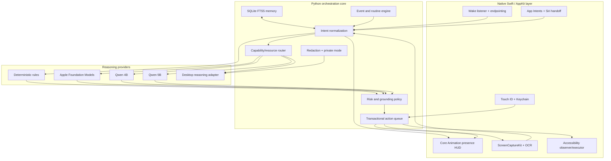
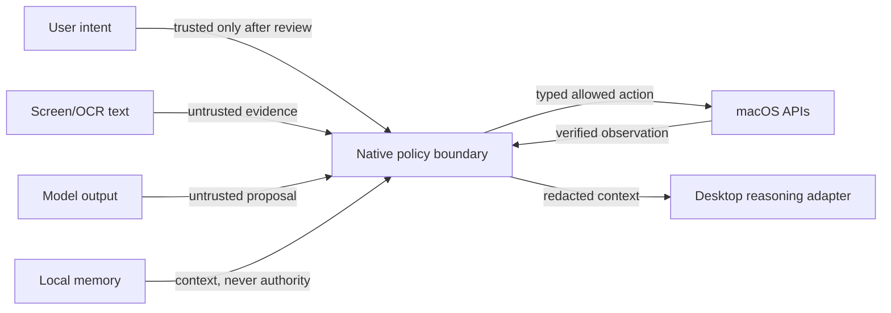

# Architecture

Jarvis separates observation, reasoning, authorization, and execution. The architecture is intentionally asymmetric: models may propose; only deterministic code may authorize and execute.

## Design goals

1. Keep idle CPU, GPU, and memory use small enough for a daily-use Mac.
2. Keep private data and ordinary commands local whenever possible.
3. Make every consequential action legible, reviewable, interruptible, and verifiable.
4. Degrade safely when a model, permission, application, microphone, or desktop handoff is unavailable.
5. Preserve continuity without turning memory or screen content into authority.

## System layers



## Request lifecycle

1. **Acquire:** a local wake word, Control-Space, menu action, App Intent, or CLI request creates an explicit request envelope.
2. **Transcribe:** Apple's on-device recognizer produces a candidate; a recorded second pass or on-demand Whisper can recover uncertain commands.
3. **Personalize:** optional owner-voice verification compares the utterance against encrypted, multi-reference speaker embeddings. Raw recordings are deleted by default.
4. **Normalize:** bounded phrase recovery uses the command catalog, active app, and full utterance. It may correct `training view` to `TradingView`; it may not invent a contact, path, URL, message, or financial action.
5. **Route:** deterministic rules handle common actions. Other requests use the smallest capable local model, subject to task usefulness, battery, memory headroom, and thermal state. Deep visual/research/coding work may go to the desktop adapter.
6. **Compile:** all action candidates become typed, allowlisted action records.
7. **Authorize:** transcript and plan previews apply confirmation by risk tier. Touch ID remains separate from voice identity.
8. **Execute:** the transaction engine checks preconditions, runs one bounded step at a time, validates postconditions, records receipts, and stops on the first unverified result.
9. **Recover:** failed work exposes a precise result, optional undo proposal, and no fabricated success state.

## Routing policy

| Layer | Intended work | Residency | Failure behavior |
|---|---|---:|---|
| Deterministic rules | common app, window, scan, time/date, and safety paths | resident code | explicit local fallback |
| Apple Foundation Models | typed lightweight planning on supported systems | system-managed | fall through locally |
| Qwen 4B | dialogue and ordinary planning | on demand | unload, then fallback/delegate |
| Qwen 9B | useful multi-step local planning | on demand | skipped under pressure |
| Desktop adapter | visual analysis, research, coding, persistent work | external process | clear handoff error; no action claim |

The router reserves reclaimable-memory headroom, listens to macOS thermal and power state, and unloads local models after inactivity. Large inference is never needed for the wake listener or ambient HUD.

## Memory model

The SQLite store separates short dialogue continuity from durable facts and procedures. Durable records include:

- category, title, and body;
- source and provenance;
- confidence and validity windows;
- privacy class and export eligibility;
- expiry, supersession, and correction links.

FTS5 supplies local retrieval. Private Mode excludes private records from desktop-bound context. Memory can inform reasoning but cannot grant permission or bypass policy.

## Trust boundaries



The local dashboard binds only to `127.0.0.1`, uses an ephemeral process token, validates the Host and Origin, sets strict cookies and security headers, and limits request bodies. The native app launches Python with a reduced environment.

## Domain workflow: TradingView review

The trading workflow is a demonstration of transactional UI automation under uncertainty:

1. verify the expected TradingView window and chart layout;
2. temporarily enable interval/date synchronization;
3. capture 5m, 15m, 1h, and 4h views with both instruments visible;
4. attach all four captures to one reasoning request;
5. restore the chart to 5m and set both synchronization controls to off—even when capture fails;
6. return decision support only, never trade execution.

The workflow's value is not financial prediction. It demonstrates explicit preconditions, multi-step evidence collection, cleanup guarantees, failure isolation, and a hard domain boundary.

## Repository map

```text
jarvis/                 Python orchestration, memory, policy, routing, and adapters
native/                 Swift app shell and privileged macOS integrations
tests/                  unit and native-source contract tests
docs/                   case study, evaluation, installation, and system notes
scripts/                repeatable verification and public-repository checks
assets/                 app icon source assets
bootstrap.command       pinned local build/install pipeline
```

Generated app bundles, model weights, local databases, captures, logs, and permission state are intentionally excluded from version control.

## Architectural limitations

- `JarvisMenuBar.swift` is currently too large and should be divided into feature modules as native tests move to XCTest.
- The desktop reasoning transport is an adapter around installed desktop software, not a stable public API.
- Accessibility automation is inherently sensitive to application UI changes.
- Source-contract tests catch critical packaging and policy regressions, but they do not replace real hardware and permission testing.
