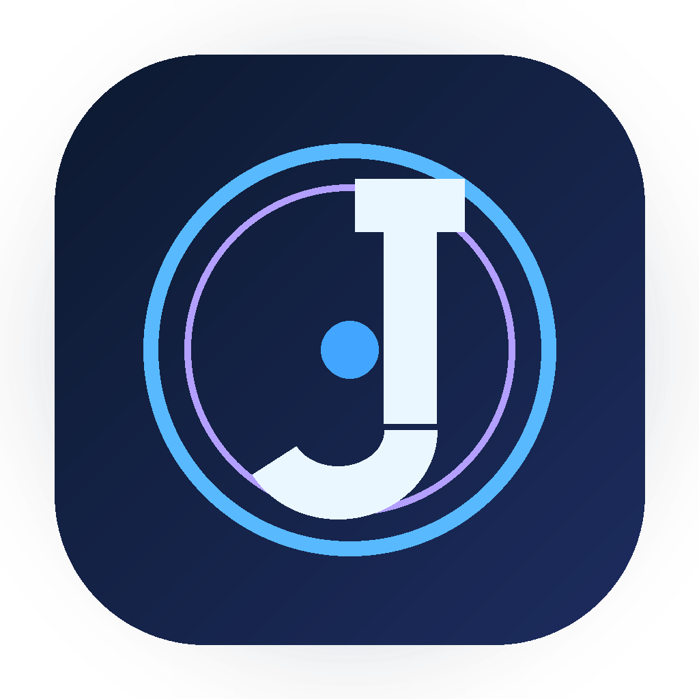
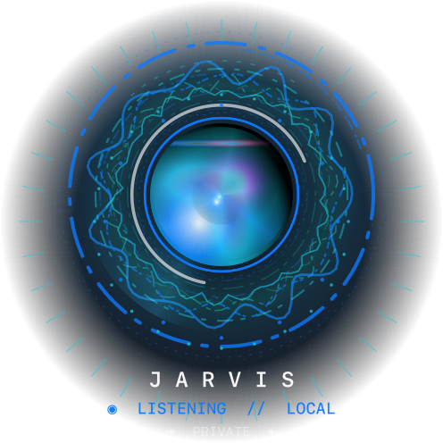
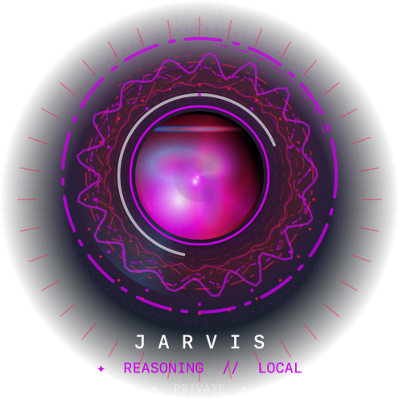
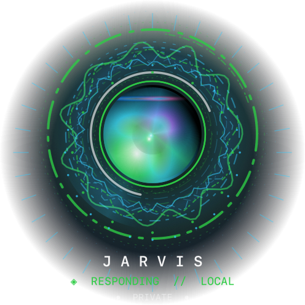
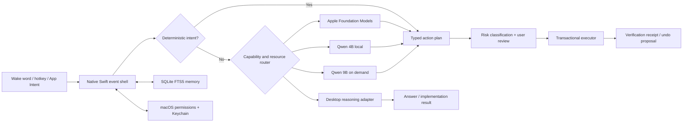

# Jarvis for macOS

<p align="center">
  
</p>

<p align="center">
  <strong>A local-first macOS AI agent with voice, structured memory, tiered model routing, and confirmation-gated computer control.</strong>
</p>

<p align="center">
  
  
  
  
  
  
</p>

Jarvis is a working research and portfolio project built to explore what a useful personal agent looks like when privacy, latency, resource limits, and safe execution are treated as product requirements—not afterthoughts.

The system keeps an event-driven native shell resident, uses deterministic rules for common actions, loads local models only when their capability is needed, and delegates deeper reasoning through a configurable desktop reasoning adapter. Consequential actions remain reviewable and interruptible.

> [!IMPORTANT]
> This repository contains source code, tests, and local build tooling. It does not ship a notarized binary. Review the permissions and safety model before installing it on a daily-use Mac.

## The interface

The ambient presence is a native Core Animation state machine. It expands from a compact menu-bar companion into distinct listening, reasoning, speaking, capture, and rejection states without keeping a language model or continuous visual-analysis process resident.

<p align="center">
  
  
  
</p>

## What this project demonstrates

- **Native voice pipeline:** wake-word listening, Apple on-device transcription, bounded noisy-room endpointing, pronunciation memory, and an on-demand Whisper fallback.
- **Owner-voice verification:** five-sample enrollment, WeSpeaker embeddings through Core ML, multi-reference matching, pitch as a secondary signal, Keychain storage, and Touch ID for profile changes.
- **Tiered reasoning:** deterministic rules first, Apple Foundation Models when available, Qwen 4B for ordinary local dialogue and planning, Qwen 9B for useful multi-step work, and a desktop handoff adapter for deeper visual or coding tasks.
- **Transactional Mac automation:** allowlisted actions, explicit plans, confirmation tiers, preconditions, postconditions, checkpoints, bounded retries, receipts, undo proposals, and an emergency stop.
- **Structured local memory:** SQLite FTS5 search with provenance, confidence, validity, privacy, expiry, correction, supersession, export, and encrypted backup support.
- **Resource-aware inference:** local models load on demand, unload after idle periods, reserve reclaimable-memory headroom, and back off under battery or macOS thermal pressure.
- **Native integrations:** App Intents, Siri microphone handoff, ScreenCaptureKit, Accessibility, Keychain, LocalAuthentication, Calendar, Reminders, Contacts, and notifications.
- **Domain workflow design:** a four-timeframe TradingView review captures 5m, 15m, 1h, and 4h evidence, restores chart state afterward, and enforces analysis-only boundaries.

## Architecture



The full component map, trust boundaries, routing logic, and failure behavior are in [ARCHITECTURE.md](ARCHITECTURE.md).

## Safety model

Jarvis treats visible screen text and model output as untrusted proposals. The native layer validates every action against an allowlist and the user's original transcript before execution.

- Voice commands receive a transcript preview.
- Mac actions receive an exact plan preview.
- Messages, file changes, settings, and Shortcuts use a stronger confirmation tier.
- Financial requests are decision support only; Jarvis cannot place, modify, or close a live trade.
- Owner voice is a personalization gate, not a replacement for Touch ID or macOS authorization.
- Private Mode blocks desktop/cloud handoff and excludes private memories from outbound context.
- Screen Recording, Accessibility, Microphone, Speech, Automation, Contacts, Calendars, and Reminders remain controlled by macOS.

See [SECURITY.md](SECURITY.md) for the threat model and responsible disclosure process.

## Quick start

### Requirements

- Apple-silicon Mac running macOS 14 or newer
- Python 3.11 or newer
- Xcode/Command Line Tools with the macOS 26 SDK to compile every optional helper
- A local ChatGPT or Codex desktop installation only if you want desktop reasoning handoffs

The app can run on macOS 14+, while Apple Foundation Models and the newest transcription path are runtime-gated to systems that support them.

### Verify the source first

```bash
git clone https://github.com/PB-Builds-creator/Jarvis-For-Mac.git
cd Jarvis-For-Mac
python3 -m venv .venv
.venv/bin/python -m pip install --constraint constraints.txt -e .
./scripts/verify.sh
```

### Build without downloading models

This compiles and signs an ad-hoc local build in an isolated temporary install root. It is the fastest way to inspect the native app and test the source without changing an existing `~/Jarvis` installation.

```bash
JARVIS_ROOT="$(mktemp -d)/Jarvis" \
JARVIS_VERIFICATION_BUILD=1 \
JARVIS_NONINTERACTIVE=1 \
./bootstrap.command
```

### Full local installation

```bash
./bootstrap.command
```

The full installer downloads several local models and creates:

```text
~/Jarvis/
├── App/          # installed Jarvis.app
├── Data/         # private database, settings, logs, and helper binaries
├── Information/  # reviewable captures and exports
└── Models/       # on-demand local model weights
```

After the first build, edit `~/Jarvis/Data/no_api_config.json` to set values such as `owner_name`, the Chat/Work workspace paths, retention choices, and an optional `approved_chrome_profile_email`. A documented example is included at [config.example.json](config.example.json).

Grant only the macOS permissions for features you intend to use. Detailed steps are in [docs/INSTALLATION.md](docs/INSTALLATION.md).

## Developer workflow

```bash
./scripts/verify.sh
./scripts/secret-scan.sh
```

The verification suite covers 186 Python and native-source contract tests: routing, confirmation policy, action validation, memory migration, dashboard isolation, screen-capture failure handling, voice intent recovery, speaker verification, resource routing, TradingView restoration, and packaging invariants.

Tests deliberately mock model inference, live screen capture, and external handoffs. Hardware permissions, wake-word quality, animation smoothness, and real ScreenCaptureKit behavior require the manual checks documented in [docs/EVALUATION.md](docs/EVALUATION.md).

## Engineering evidence

- [Case study](docs/CASE_STUDY.md) — problem, constraints, major iterations, failures, and measured outcomes
- [Evaluation protocol](docs/EVALUATION.md) — what is automated, what needs hardware, and how results are reported
- [Verification record](docs/VERIFICATION.md) — dated evidence for this public snapshot and explicit manual gaps
- [Presence system](docs/JARVIS_PRESENCE_SYSTEM.md) — animation lifecycle and performance contract
- [AI-assisted engineering](docs/AI_ASSISTED_ENGINEERING.md) — transparent authorship and verification statement
- [Contributing](CONTRIBUTING.md) — setup, quality bar, and pull-request expectations
- [Third-party notices](THIRD_PARTY_NOTICES.md) — model provenance and licenses

## Current limitations

- The build is Apple-silicon and macOS-specific.
- The desktop handoff adapter depends on locally installed desktop software and may need updates when that software changes.
- Voice biometrics can be attacked by recordings or sufficiently capable voice cloning; Touch ID remains mandatory for protected credentials and profile changes.
- Ad-hoc builds are suitable for local development, not public binary distribution. A Developer ID, notarization, and release pipeline are required before shipping downloads.
- The TradingView integration depends on visible Accessibility labels and layout assumptions. It fails closed when required controls or captures cannot be verified.

## Roadmap

- Replace desktop-specific deep-reasoning transport with a documented provider interface.
- Add a replayable, privacy-safe voice-command evaluation corpus.
- Move native contract checks into an XCTest target while retaining source-policy tests.
- Add Developer ID signing, notarization, SBOM generation, and signed release provenance.
- Generalize domain workflows into declarative, user-editable capability packs.

## Project status and attribution

Jarvis is an independently developed, AI-assisted personal research project. Product requirements, architecture decisions, safety constraints, integration testing, and final acceptance are human-owned; AI tools were used as implementation and research collaborators. The disclosure is detailed in [docs/AI_ASSISTED_ENGINEERING.md](docs/AI_ASSISTED_ENGINEERING.md).

The project name is a personal codename. This repository is not affiliated with or endorsed by Marvel, Apple, OpenAI, TradingView, Qwen, or the third-party model authors.

Licensed under the [Apache License 2.0](LICENSE).
